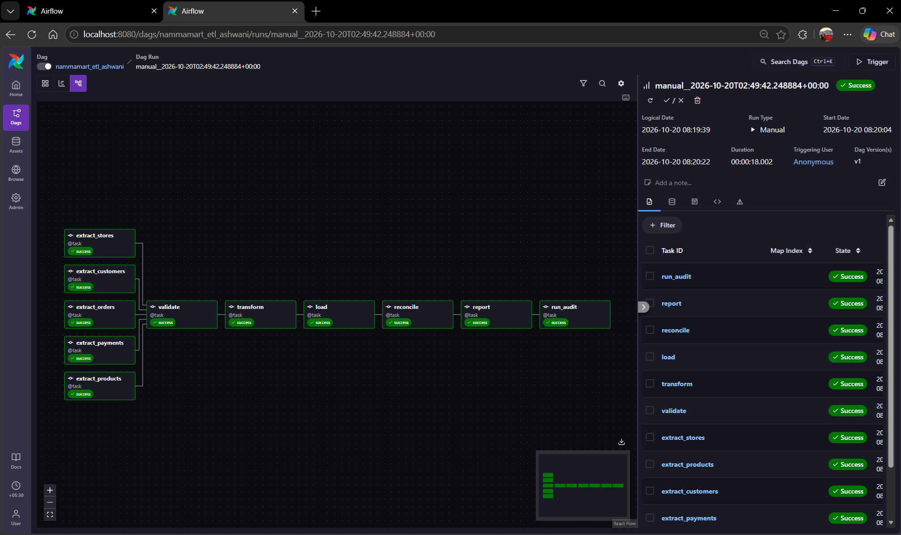
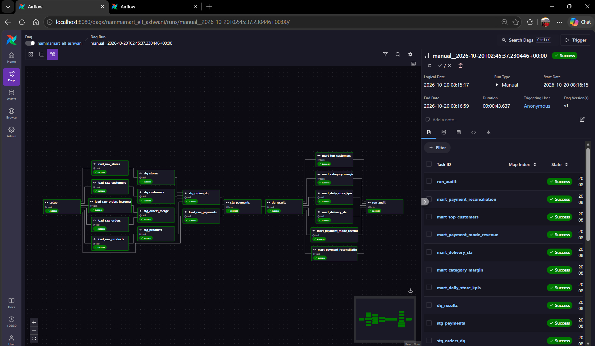
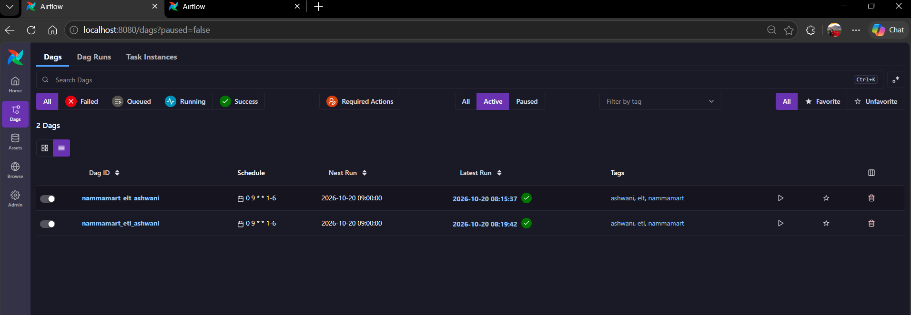
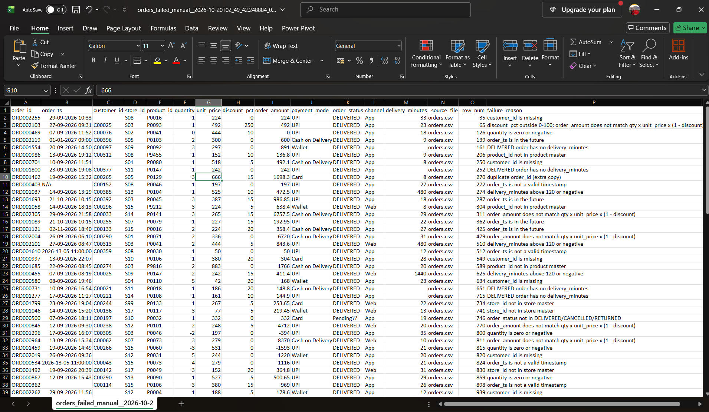
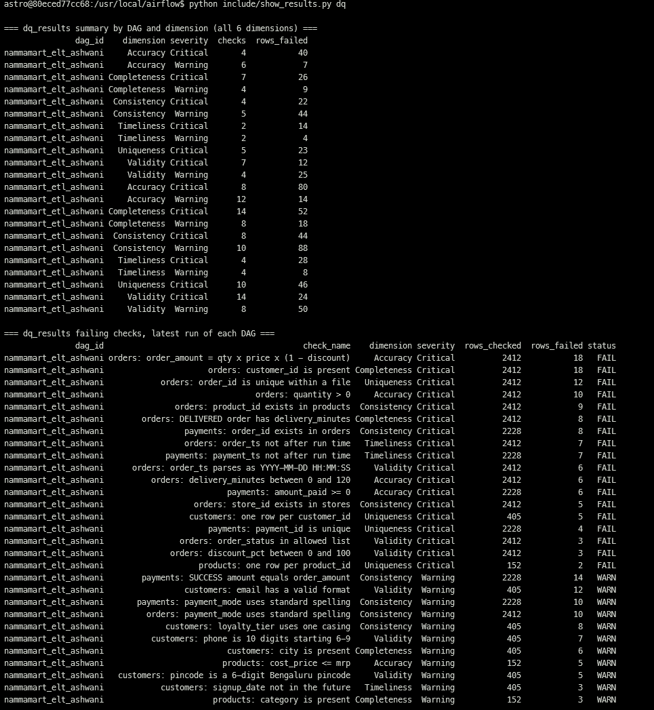
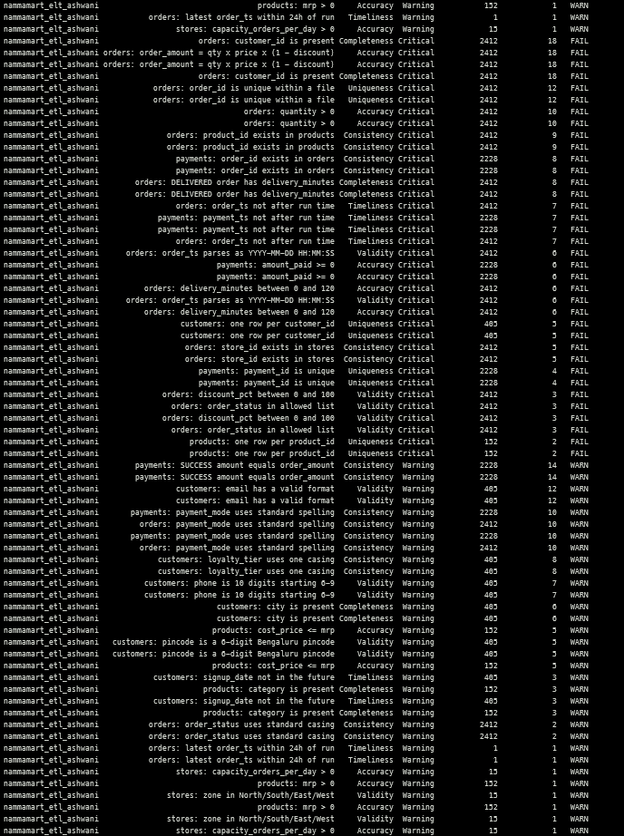
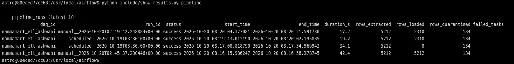
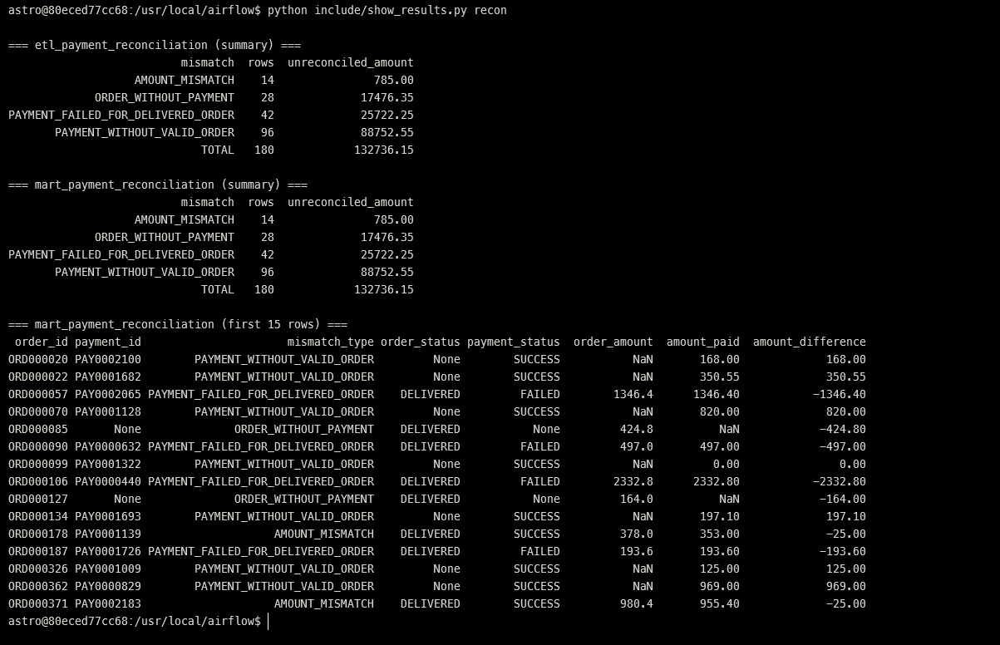

# NammaMart Quick Commerce: ETL & ELT Pipelines

FDAIE Module 2 · Data Engineering Foundations · Submission by **Ashwani Maurya**

## What is in this repository

| Path | What it is |
| --- | --- |
| `dags/nammamart_etl_ashwani.py` | ETL DAG: Extract → Validate (pandas) → Quarantine → Transform → Load (star schema) → Reconcile → Report → Run audit |
| `dags/nammamart_elt_ashwani.py` | ELT DAG: Load raw → Staging SQL (incl. MERGE of the increment file) → Mart SQL → Run audit |
| `include/nammamart/` | Helper code: `config.py` (paths, rules), `dq_catalog.py` (the 50 checks, shared by both DAGs), `quality.py` (pandas checks + masking), `etl.py`, `elt.py`, `warehouse.py` (dq_results, pipeline_runs), `dag_utils.py` (schedule, retries, Slack alert, run audit) |
| `include/sql/elt/` | All ELT transformations as SQL: `00_setup.sql` (macros, masking), `staging/*.sql`, `mart/*.sql` |
| `include/sql/reconciliation.sql` | Order vs payment reconciliation (used by both pipelines) |
| `include/sql/business_questions.sql` | The six business questions, one query per pipeline |
| `include/show_results.py` | Prints the screenshot tables (`pipeline_runs`, `dq_results`, payment reconciliation, latest quarantine file): `astro dev bash` then `python include/show_results.py` |
| `include/data/nammamart/` | The five source files, copied unchanged from `assignment/nammamart_dataset/` |
| `include/quarantine/ashwani/` | Quarantine files written by the ETL DAG. Git-ignored: rejected customer rows keep their raw email and phone (screenshot 4 shows one) |
| `tests/nammamart/test_pipelines.py` | Automated checks: ETL = ELT, re-run is idempotent, increment upserts correctly |
| `include/warehouse_ashwani.duckdb` | Created on first run. Git-ignored on purpose: `raw_customers` holds unmasked PII |

### How to run

```bash
astro dev restart                                   # picks up requirements.txt (duckdb>=1.4 for MERGE)
astro dev run dags list-import-errors               # should print "No data found"
astro dev run dags test nammamart_etl_ashwani        # or trigger both DAGs from the UI
astro dev run dags test nammamart_elt_ashwani
# Experiment 3 (incremental load):
cp assignment/nammamart_dataset/orders_2026-10-01_increment.csv include/data/nammamart/
```

Optional Slack alert (bonus): Admin → Variables → add `SLACK_WEBHOOK_URL`. Without it, alerts print to the task log.

Tests (no Airflow needed): `pytest tests/nammamart -q` → 3 passed.

---

## Part 0: Discovery and data profiling

### Profile summary

| File | Rows | Distinct keys | Key problems found |
| --- | --- | --- | --- |
| orders.csv | 2,412 | 2,400 `order_id` | 12 exact duplicate rows, 18 blank `customer_id`, 8 DELIVERED with no `delivery_minutes`, 6 unparseable and 7 future `order_ts`, 5 bad statuses (3 `Pending??`, 2 `delivered`), 10 non-standard payment modes, 10 zero/negative quantities, 3 discounts > 100%, 15 more amounts that break the formula, 6 delivery times of 480–1,440 min, 5 unknown stores, 9 unknown products |
| payments.csv | 2,228 | 2,224 `payment_id` | 4 exact duplicates, 8 payments for orders that don't exist, 6 negative and 4 zero amounts, 7 future timestamps, 14 SUCCESS amounts lower than the order, 44 FAILED payments on DELIVERED orders, 10 non-standard modes |
| customers.csv | 405 | 400 `customer_id` | 5 duplicated customers (different phone/area), 12 invalid emails, 7 short phones, 5 bad pincodes, 6 blank cities, 8 mis-cased loyalty tiers, 3 future signup dates |
| products.csv | 152 | 150 `product_id` | 2 duplicated products (an "(old)" row), 3 blank categories, 1 negative MRP, 4 products with cost above MRP |
| stores.csv | 15 | 15 `store_id` | 1 blank zone, 1 store with capacity 0 |
| orders_2026-10-01_increment.csv | 160 | 160 | Clean. 150 new orders on 1 Oct + 10 corrections (DELIVERED → RETURNED) to September orders |

Distinct values: `order_status` = DELIVERED 2,182, CANCELLED 156, RETURNED 69, `Pending??` 3, `delivered` 2. `payment_mode` = UPI, Card, Cash on Delivery, Wallet + `upi`, `UPI `, `CARD`, `cod`, `Cashh`. `loyalty_tier` = Bronze, Silver, Gold, Platinum + `BRONZE`, `bronze`, `SILVER`. `zone` = North, South, East, West + blank. `category` = 6 categories + blank. Numeric ranges: `quantity` −3 to 5, `discount_pct` 0 to 250, `order_amount` −1,593 to 9,576, `delivery_minutes` 8 to 1,440, `mrp` −203 to 883, `amount_paid` −1,593 to 9,576. Dates: `order_ts` 2026-09-01 to 2027-01-01, `signup_date` up to 2027-01-05.

Referential integrity: orders → customers OK for every non-blank id; orders → stores 5 rows fail (S00, S17 ×3, S99); orders → products 9 rows fail (P9xxx ids); payments → orders 8 rows fail (ORD9xxxxx ids). Cancelled orders correctly have no payment.

### Data Issues Log

| # | File | Row key(s) | Column | Problem | Dimension | Proposed rule | Severity |
| --- | --- | --- | --- | --- | --- | --- | --- |
| 1 | orders | ORD000539, ORD000783, ORD001110, ORD001239, ORD001326, ORD001434, ORD001441, ORD001462, ORD001549, ORD001692, ORD001870, ORD002129 | order_id | Exact duplicate rows (double counts revenue) | Uniqueness | Keep the first copy, quarantine the extra copy | Critical |
| 2 | orders | ORD000022, ORD000580, ORD000583, ORD000701, ORD000764, ORD000790, ORD000997, ORD001332, ORD001373, ORD001532, ORD001918, ORD002019, ORD002149, ORD002156, ORD002219, ORD002255, ORD002262, ORD002367 | customer_id | Blank | Completeness | `customer_id` not null | Critical |
| 3 | orders | ORD000326, ORD000731, ORD000878, ORD001277, ORD001515, ORD001554, ORD001800, ORD002229 | delivery_minutes | DELIVERED order with no delivery time | Completeness | DELIVERED ⇒ `delivery_minutes` present | Critical |
| 4 | orders | ORD000403 (`N/A`), ORD000362 (blank), ORD000534 & ORD001610 (`2026-13-05`), ORD000946 & ORD002012 (`31/09/2026 10:00`) | order_ts | Not a valid `YYYY-MM-DD HH:MM:SS` timestamp | Validity | Strict timestamp parse | Critical |
| 5 | orders | ORD001089, ORD001693 (2026-10-21), ORD001121, ORD001965 (2026-11-02), ORD001725, ORD001765, ORD002119 (2027-01-01) | order_ts | Future-dated order | Timeliness | `order_ts` ≤ run time | Critical |
| 6 | orders | ORD000500, ORD001637, ORD001970 | order_status | `Pending??` is not an allowed status | Validity | Status in DELIVERED/CANCELLED/RETURNED | Critical |
| 7 | orders | ORD000153, ORD001066 | order_status | `delivered` lower case | Consistency | Upper-case, then log | Warning |
| 8 | orders, payments | 10 rows in each file | payment_mode | `upi`, `UPI ` (trailing space), `CARD`, `cod`, `Cashh` | Consistency | Trim + map aliases to UPI / Card / Cash on Delivery | Warning |
| 9 | orders | ORD000099, ORD000469, ORD001724, ORD002360 (0); ORD000462, ORD000867, ORD001124, ORD001296, ORD001384, ORD001459 (negative) | quantity | Zero or negative quantity (negative amounts follow) | Accuracy | `quantity > 0` | Critical |
| 10 | orders | ORD001237 (150), ORD001468 (120), ORD002103 (250) | discount_pct | Discount above 100% | Validity | 0 ≤ `discount_pct` ≤ 100 | Critical |
| 11 | orders | ORD000845, ORD000964, ORD001624, ORD002004, ORD002031, ORD002305 (×10); ORD000677, ORD000801, ORD000880, ORD002128, ORD002244 (×1.5); ORD001274, ORD001755, ORD002223, ORD002298 (×0.5) | order_amount | Doesn't equal qty × price × (1 − discount); the six ×10 rows alone would add ₹35,410.95 of revenue that doesn't exist | Accuracy | Recompute; mismatch > ₹0.01 fails | Critical |
| 12 | orders | ORD000020, ORD001104 (900), ORD000424, ORD001037, ORD002101 (480), ORD000455 (1,440) | delivery_minutes | 8–24 *hours*, likely hours or a timestamp gap entered as minutes | Accuracy | 0 ≤ minutes ≤ 120 | Critical |
| 13 | orders | ORD001799 (S99), ORD002126 (S00), ORD001046, ORD001275, ORD001492 (S17) | store_id | Store not in master | Consistency | FK to stores | Critical |
| 14 | orders | ORD000070, ORD000134, ORD000596, ORD000789, ORD000965, ORD000986, ORD001058, ORD001685, ORD002179 | product_id | P9xxx ids not in catalogue (look like test SKUs) | Consistency | FK to products | Critical |
| 15 | orders | 27 DELIVERED + 1 RETURNED orders | – | No payment record at all | Consistency | Report in reconciliation, don't reject | Warning |
| 16 | payments | PAY0000509, PAY0000755, PAY0001651, PAY0002000 | payment_id | Exact duplicate rows | Uniqueness | Keep first, quarantine copy | Critical |
| 17 | payments | PAY0002217 – PAY0002224 | order_id | ORD9xxxxx orders that don't exist; all UPI at the same second (2026-09-18 14:22:10), ₹4,580.57 total; look like test transactions | Consistency | FK to orders | Critical |
| 18 | payments | PAY0000737, PAY0000751, PAY0000791, PAY0000944, PAY0001568, PAY0002175 | amount_paid | Negative SUCCESS payments (mirror negative-quantity orders) | Accuracy | `amount_paid ≥ 0` | Critical |
| 19 | payments | PAY0000127, PAY0000267, PAY0000337, PAY0000396, PAY0001037, PAY0001488, PAY0001908 | payment_ts | Future-dated (same orders as #5) | Timeliness | `payment_ts` ≤ run time | Critical |
| 20 | payments | 14 rows, e.g. PAY0000586 (paid ₹2.60 for a ₹102.60 order), PAY0000909, PAY0001813 | amount_paid | SUCCESS amount is exactly ₹25 / ₹50 / ₹100 below the order (coupon or wallet credit not in the order export?) | Consistency | Must equal `order_amount`; listed in reconciliation | Warning |
| 21 | payments | 44 rows | payment_status | FAILED payment on a DELIVERED order (revenue counted, money not received) | Consistency | Listed in reconciliation | Warning |
| 22 | payments | all 301 Cash on Delivery rows | gateway_ref | Blank. Expected for cash, so the rule only applies to non-cash payments (0 failures) | Completeness | Non-cash ⇒ `gateway_ref` present | Warning |
| 23 | customers | C00036, C00103, C00226, C00252, C00313 | customer_id | Two rows each, different phone and/or area | Uniqueness | One row per customer; keep first, quarantine the other (ask client which is current) | Critical |
| 24 | customers | C00045, C00193, C00327, C00337 (`N/A`); C00062, C00067, C00307, C00363, C00392 (no `@`); C00063, C00112, C00310 (no domain suffix) | email | Invalid email | Validity | Email regex; masked value set to NULL | Warning |
| 25 | customers | C00095, C00130, C00151, C00240, C00290, C00339, C00357 | phone | 7–9 digits instead of 10 | Validity | 10 digits starting 6–9 | Warning |
| 26 | customers | C00083, C00132, C00166 (`5600XX`); C00342, C00395 (`000000`) | pincode | Not a Bengaluru pincode | Validity | `560\d{3}` | Warning |
| 27 | customers | C00142, C00219, C00233, C00328, C00355, C00394 | city | Blank | Completeness | City present | Warning |
| 28 | customers | 8 rows (`BRONZE` ×3, `bronze` ×3, `SILVER` ×2) | loyalty_tier | Mixed casing | Consistency | Title case | Warning |
| 29 | customers | C00038 (2026-12-20), C00398 (2026-11-12), C00400 (2027-01-05) | signup_date | Future signup, yet they ordered in September | Timeliness | Signup ≤ run date; set to NULL in reports | Warning |
| 30 | products | P0030, P0140 | product_id | Second row named "… (old)" with a lower MRP | Uniqueness | Keep the current row, quarantine "(old)" | Critical |
| 31 | products | P0051, P0060, P0068 | category | Blank (all are Staples: Dal, Rice, Oil) | Completeness | Category present; report as `Unknown` | Warning |
| 32 | products | P0109 | mrp | −203 (orders sell it at ₹203, so the sign is wrong) | Accuracy | `mrp > 0` | Warning |
| 33 | products | P0019, P0073, P0074, P0117 | cost_price | Exactly 1.2 × MRP, so every sale is a loss | Accuracy | `cost_price ≤ mrp` | Warning |
| 34 | stores | S07 (BTM Layout) | zone | Blank | Completeness/Validity | Zone in N/S/E/W; report as `Unknown` | Warning |
| 35 | stores | S12 (Rajajinagar) | capacity_orders_per_day | 0, but it takes ~9 orders a day | Accuracy | Capacity > 0 | Warning |
| 36 | increment | ORD000017, ORD000271, ORD000332, ORD000337, ORD000584, ORD000708, ORD000822, ORD001025, ORD001067, ORD001990 | order_status | Status corrections to September orders, not errors | – | Upsert on `order_id` | – |

Severity rule I applied: in the fact files (orders, payments) every rule from the brief is Critical. In the master files only key problems (null or duplicate id) are Critical; attribute problems are Warnings. Quarantining a whole customer, product or store for a bad email or a missing zone would also reject every genuine, paid order that points to it (S07 alone has 145 delivered orders worth ₹82,725). Those rows load, flagged, and appear in `dq_results`.

### Questions for the client

1. **Delivery times of 480, 900 and 1,440 minutes:** are these hours typed as minutes, or orders that really took a day? Should we correct them or keep rejecting them?
2. **Payments ₹25/₹50/₹100 below the order amount:** is there a coupon or wallet credit that the order export doesn't show? If yes, finance needs that column; otherwise these are short-collections.
3. **Master-data problems:** is it acceptable to load an order whose store has no zone (S07) or whose product has no category, flagged as `Unknown`, rather than reject the order? Which zone does S07 (BTM Layout) belong to?
4. (Bonus) For duplicated customers with two phone numbers, which system is the source of truth for the current phone and area?

---

## Part A and Part B: the two pipelines

| | ETL (`nammamart_etl_ashwani`) | ELT (`nammamart_elt_ashwani`) |
| --- | --- | --- |
| Extract | 5 parallel `extract_*` tasks (orders also picks up any `orders_*_increment.csv`) | 6 parallel `load_raw_*` tasks, including `load_raw_orders_increment` |
| Where bad rows go | `include/quarantine/ashwani/<file>_failed_<run_id>.csv` + `etl_quarantine` table, with `failure_reason` | Stay in `stg_*` with `dq_status = 'FAIL'` and `failure_reason`; raw keeps them untouched |
| Transform | pandas: trim, fix casing, map payment-mode aliases, dedupe, mask PII, join, derive `order_date`, `net_revenue`, `gross_margin`, `within_15_min` | SQL only (`include/sql/elt/`), same rules |
| Tables | `etl_fact_orders`, `etl_dim_customer`, `etl_dim_product`, `etl_dim_store`, `etl_payment_reconciliation`, `etl_daily_zone_revenue`, `etl_category_margin` | `raw_*` (5), `stg_*` (5), `mart_daily_store_kpis`, `mart_category_margin`, `mart_delivery_sla`, `mart_payment_reconciliation`, `mart_top_customers`, `mart_payment_mode_revenue` |
| Idempotency | Dimensions replaced in a transaction; fact `INSERT OR REPLACE` on `order_id` | Raw: a file whose MD5 is already loaded is not appended again (`raw_load_log`); `stg_orders` is a `MERGE` on `order_id` + copy number; other tables rebuilt |
| Increment | Later file's row wins per `order_id` before validation, then upsert | `MERGE INTO stg_orders` → 10 rows updated to RETURNED, 150 inserted |
| Shared | Same 50 checks (`include/nammamart/dq_catalog.py`), same `dq_results`, `pipeline_runs`, same reconciliation SQL | |

**September totals match exactly** (happy path, before the increment):

| Measure | ETL | ELT |
| --- | --- | --- |
| Delivered orders | 2,088 | 2,088 |
| Net revenue | ₹11,35,628.80 | ₹11,35,628.80 |
| Gross margin | ₹2,60,999.43 | ₹2,60,999.43 |
| Rows failing each of the 50 checks | identical | identical |
| Reconciliation rows | 180 | 180 |

They match because both pipelines apply the same rules (one shared check catalogue) and the same reconciliation SQL; `tests/nammamart/test_pipelines.py` asserts this on every run. After the increment both show 2,460 orders in the fact and ₹12,11,087.30 net revenue.

---

## Part C: Scheduling

Both DAGs: `schedule="0 9 * * 1-6"`, `start_date=pendulum.datetime(2026, 10, 1, tz="Asia/Kolkata")`, `catchup=False`, `max_active_runs=1`, `dagrun_timeout=25 min`, and in `default_args`: `retries=2`, `retry_delay=1 min`, `execution_timeout=10 min`, `on_failure_callback` (Slack).

- **Cron expression:** `0 9 * * 1-6`: minute 0, hour 9, every day of month, every month, Monday (1) to Saturday (6).
- **Time shown in UTC:** 03:30 UTC (IST is UTC+5:30 and has no daylight saving). The Airflow UI shows UTC by default, so the next run reads `03:30`; switching the UI timezone to Asia/Kolkata shows `09:00`. Verified with `airflow dags next-execution`.
- **If `start_date` had been left in UTC:** the cron would be read in UTC, so the run would start at 09:00 UTC = **14:30 IST**, five hours after the 9:30 stand-up. The report would always be a day late in practice.
- **If the laptop or Docker is off at 9 AM:** no scheduler is running, so nothing runs and nobody is alerted (the alert also lives inside Airflow). When Airflow starts again, `catchup=False` makes it create one run for the most recent missed slot and run it immediately, not one run per missed day. For the real client this must run on an always-on host (Astro Deployment or a small VM), plus an external check that `pipeline_runs` has a success row by 09:15.
- **Why `catchup=False`:** every run re-reads the complete exports (orders.csv already covers the whole month), so replaying each missed day would process the same files again and again. The loads are idempotent, so that would be harmless but slow and noisy.
- **Why retries 2 × 1 min and a 10 min task timeout:** the likely failures at 9 AM are transient (a file still being copied, or the other DAG holding the DuckDB write lock for a few seconds). Two retries a minute apart cover those and still finish well before 9:30; a hard failure is reported by about 9:05. `execution_timeout` stops a hung task from silently eating the window, and `dagrun_timeout=25 min` fails the whole run before the stand-up.

---

## Part D: Data quality dimensions

50 checks, all implemented twice: in pandas (`include/nammamart/quality.py`) and in SQL (`include/sql/elt/staging/*.sql`), with the same check codes. Each run writes one row per check to `dq_results` (`run_id, dag_id, check_code, check_name, dimension, severity, rows_checked, rows_failed, status, checked_at`).

| Dimension | Checks (file) | Severity |
| --- | --- | --- |
| Completeness | order_id, customer_id present; DELIVERED has delivery_minutes; payment_id present; customer_id, product_id, store_id present in masters; city, category present; gateway_ref for non-cash; order volume not down > 90% | Critical / Warning |
| Uniqueness | order_id (per file), payment_id, customer_id, product_id, store_id | Critical |
| Validity | order_ts and payment_ts parse; order_status, payment_mode, payment_status in lists; discount 0–100; email, phone, pincode format; zone in list | Critical (status, timestamp) / Warning (email, phone, pincode, zone) |
| Accuracy | quantity > 0; order_amount formula; delivery_minutes ≤ 120; amount_paid ≥ 0; mrp > 0; cost ≤ mrp; capacity > 0; delivery 8–35 normal; unit_price within 1.5× MRP (drift); daily orders ≤ store capacity | Critical / Warning |
| Consistency | customer/store/product FKs; payment → order FK; SUCCESS amount = order amount; status, payment-mode and loyalty-tier casing | Critical (keys) / Warning (casing, amounts) |
| Timeliness | no future order_ts / payment_ts (Critical); no future signup_date; newest order within 24 h of run (Warning) | Critical / Warning |

Happy-path scorecard (both DAGs identical): 18 Critical checks failed on 134 distinct rows (orders 102, payments 25, customers 5, products 2), 16 Warning checks fired, and 85 rows loaded with `dq_status = 'WARN'`. The freshness warning fires on every run because the newest valid order is 30 September; that is correct for this static dataset.

---

## Part E: Data governance

1. **Ownership.** Orders: Head of Operations (OMS). Payments: Finance Controller (gateway). Customers: CRM / Marketing lead (and they are the PII data owner). Products: Category Management. Stores: Ops / store network lead. Warehouse tables and both pipelines: the data team (me as FDE until handover). A change to a quality rule such as the 120-minute limit is proposed by the data team and approved by the owner of the data it affects (Ops for delivery time) with Finance signing off if it changes revenue; the rule lives in `config.py`, so the change is one reviewed commit.
2. **Data dictionary.** See the table at the end of this section.
3. **Lineage.** Example: `mart_daily_store_kpis`, 2026-09-01, store S01, `net_revenue = 2,247.80`. In ELT: `int_orders_clean` gives the 4 orders (ORD000013, ORD000025, ORD000058, ORD000066), each carrying `_source_file = orders.csv` and `_row_num` (1368, 727, 443, 1653), and `raw_orders` holds those exact rows with `_run_id` and `_loaded_at`. In ETL, `etl_fact_orders` also keeps `_source_file` and `_source_row`, but nothing between the CSV and the fact is stored, so to see the row "as received" you go back to the file, and if the file has since been replaced you can't. ELT is easier: every hop is a table you can query.
4. **Personal data.** `customers.full_name`, `email`, `phone`; also `area` + `pincode` together with a name (quasi-identifiers), and `stores.manager_name` (employee PII). Masking: email → `pr***@example.com`, phone → `98******21`, name → `Priya H.`; pincode kept only when valid. Masking rather than deleting keeps the column usable (support can confirm "is this your number ending 21?", analysts can still count distinct customers) while removing what identifies a person. The **Digital Personal Data Protection Act, 2023 (DPDP Act)** applies: process only for the stated purpose with consent, collect the minimum, keep it secure, delete it when the purpose ends, honour access/correction/erasure requests, and report breaches to the Data Protection Board.
5. **Access control.** Raw and quarantine: data engineers only (they contain everything as received). Staging: data engineers and analysts. Marts: business users, the CFO dashboard and analysts. Unmasked phone in `raw_customers`: nobody in analytics; only the CRM/support system, which already holds it. In practice: a separate schema or file for raw with its own credentials, and marts exposed through a read-only user.
6. **Retention.** Raw: 13 months (a full year for audit plus a buffer), then archived to cold storage and deleted per the DPDP purpose limit; aggregates in marts can be kept longer because they carry no PII. Quarantine files: 90 days (long enough to fix and replay), then deleted. Masked customer data: while the customer is active plus the statutory period finance needs (e.g. 8 years for tax records of transactions); customers who request erasure are deleted from raw and pseudonymised elsewhere.
7. **Secrets.** `SLACK_WEBHOOK_URL` is an Airflow Variable (Admin → Variables, or an environment variable / secrets backend in production), read at run time with `Variable.get` inside the failure callback. It is never in the DAG file or on GitHub because anyone with repo access could post to the channel, Git history keeps it forever even after deletion, and rotating it would mean a code change. `.gitignore` also excludes `airflow_settings.yaml` and `.env`.
8. **Audit (rejected order).** Example ORD001624 (amount ₹9,576 vs formula ₹957.60). ETL: `include/quarantine/ashwani/orders_failed_<run>.csv` and `SELECT * FROM etl_quarantine WHERE row_key = 'ORD001624'` show the row exactly as received (`raw_record` JSON), its file and line, and `failure_reason`; `SELECT count(*) FROM etl_fact_orders WHERE order_id = 'ORD001624'` returns 0, so it can't be in the CFO total. ELT: `SELECT * FROM raw_orders WHERE order_id = 'ORD001624'` shows it as received, `stg_orders` shows `dq_status = 'FAIL'` and the reason, and `int_orders_clean` (which every mart reads) excludes it.
9. **Change history.** An order DELIVERED on 3 Sep and RETURNED on 1 Oct: after the increment both pipelines show it as RETURNED, so it drops out of September's net revenue (both totals fall by the same amount: ₹4,193.70 for the 10 corrected orders). Finance usually wants both: "revenue as reported on 30 Sep" (for the closed month) and "revenue as currently known" (net of returns). ELT can rebuild the first view because `raw_orders` keeps the old row with its `_loaded_at`; ETL can't without a snapshot. The clean fix is to keep history: an `order_status_history` table (or SCD Type 2 on the fact with `valid_from`/`valid_to`), and to book the return as a negative adjustment dated 1 Oct instead of rewriting September.

### Data dictionary (ETL star schema; ELT staging/mart columns use the same names)

| Table | Column | Type | Meaning | Source | Allowed values | PII |
| --- | --- | --- | --- | --- | --- | --- |
| etl_fact_orders | order_id | VARCHAR (PK) | Order number | orders.order_id | ORDnnnnnn | No |
| | order_ts / order_date | TIMESTAMP / DATE | When the order was placed (IST) | orders.order_ts | ≤ run time | No |
| | customer_id, store_id, product_id | VARCHAR | Keys to the dimensions | orders | Must exist in masters | Indirect (customer_id) |
| | quantity, unit_price, discount_pct | INT, DOUBLE, DOUBLE | Line details | orders | qty > 0, discount 0–100 | No |
| | order_amount | DOUBLE | qty × price × (1 − discount/100) | orders | Matches formula | No |
| | payment_mode | VARCHAR | Standardised mode | orders.payment_mode | UPI, Card, Cash on Delivery, Wallet | No |
| | order_status | VARCHAR | Latest known status | orders / increment | DELIVERED, CANCELLED, RETURNED | No |
| | delivery_minutes | INT | Minutes to deliver | orders | 0–120 | No |
| | net_revenue | DOUBLE | order_amount if DELIVERED, else 0 | derived | ≥ 0 | No |
| | cost_amount, gross_margin | DOUBLE | qty × cost_price; net_revenue − cost | derived + products | – | No |
| | within_15_min | BOOLEAN | Delivered in ≤ 15 min | derived | – | No |
| | category, zone | VARCHAR | Denormalised for reporting | products, stores | 6 categories / 4 zones / Unknown | No |
| | dq_status, warning_reason | VARCHAR | PASS or WARN, and why | validation | PASS, WARN | No |
| | _source_file, _source_row, _run_id, _loaded_at | – | Lineage | pipeline | – | No |
| etl_dim_customer | customer_id | VARCHAR (PK) | Customer | customers | Cnnnnn | Indirect |
| | customer_name_masked | VARCHAR | First name + last initial | customers.full_name | – | Masked |
| | email_masked, phone_masked | VARCHAR | `pr***@domain`, `98******21` | customers | NULL if invalid email | Masked |
| | city, area, pincode | VARCHAR | Location | customers | pincode 560xxx or NULL | Quasi |
| | signup_date | DATE | Signup (NULL if in the future) | customers | ≤ run date | No |
| | loyalty_tier, is_active | VARCHAR, BOOLEAN | Tier, active flag | customers | Bronze/Silver/Gold/Platinum | No |
| etl_dim_product | product_id | VARCHAR (PK) | Product | products | Pnnnn | No |
| | product_name, category, sub_category, brand, unit | VARCHAR | Catalogue attributes | products | category or `Unknown` | No |
| | mrp, cost_price | DOUBLE | Prices | products | mrp > 0, cost ≤ mrp (warned) | No |
| | is_perishable, launch_date | BOOLEAN, DATE | – | products | – | No |
| etl_dim_store | store_id | VARCHAR (PK) | Dark store | stores | S01–S15 | No |
| | store_name, area, pincode, open_date | – | Store details | stores | – | No |
| | zone | VARCHAR | Zone | stores | North, South, East, West, Unknown | No |
| | manager_name | VARCHAR | Store manager | stores | – | Yes (employee) |
| | capacity_orders_per_day | INT | Planned daily capacity | stores | > 0 (warned) | No |

---

## Part F: Observability tests

Run audit: the last task of each DAG (`run_audit`, `trigger_rule="all_done"`, no retries) writes one row per run to `pipeline_runs` (`run_id, dag_id, start_time, end_time, rows_extracted, rows_loaded, rows_quarantined, status, failed_tasks`). If any task failed it records `failed` with the task names, then fails itself so the run also shows red in the UI.

Experiments 1–9 were run with `airflow dags test` (Airflow 3.1) against a copy of the data, so the broken inputs never touched `include/data/`. `dags test` runs tasks one at a time, so the parallelism and timings below are indicative. The happy path was then run again in Astro (see the screenshots), where ETL took 17–19 s and ELT 34–42 s. "Where I saw it" refers to the same places in the Airflow UI.

| # | Experiment | Expected | Observed (ETL / ELT) | Where I saw it | What I would change |
| --- | --- | --- | --- | --- | --- |
| 1 | Happy path | Both green; same totals | Both green. ETL ~21 s, ELT ~38 s. Rows in → quarantined: orders 2,412 → 102, payments 2,228 → 25, customers 405 → 5, products 152 → 2, stores 15 → 0. The 5 extracts (ETL) and 6 raw loads (ELT) have no dependencies between them, so they run in parallel; the 3 master staging tables and the 6 marts also run in parallel | `[Validate]` log lines, Grid view durations, `pipeline_runs` | Nothing |
| 2 | Re-run | No change anywhere | ETL: fact stayed 2,310 rows (all upserts, 0 inserts). ELT: every file logged `skipped_identical`, raw did **not** grow, MERGE inserted 0. Correct: re-running must not double count, and raw only needs a file once | `[Load]` / `[Load raw]` log lines, `raw_load_log` | Nothing |
| 3 | Increment | 150 inserted, 10 updated, no duplicates | ETL: fact 2,310 → 2,460 (150 inserted). ELT: `MERGE` "inserted 150, overwrote 10". All 10 corrected orders show RETURNED in both, `count(*) = count(DISTINCT order_id)`. Net revenue ₹12,11,087.30 in both | `[MERGE]` log, fact/stg queries, `tests/nammamart` | Keep increment files in the folder as history: both pipelines re-apply every file present, so deleting it would revert the 10 returns |
| 4 | Missing `products.csv` | Retries, then fail, alert | `extract_products` / `load_raw_products`: `FileNotFoundError` → `up_for_retry` twice (1 min apart) → `failed` after ~2 min 15 s. ETL: everything downstream `upstream_failed`. ELT: unaffected branches (stores, customers, orders MERGE) still succeeded; products, orders DQ, payments, dq_results and marts `upstream_failed`. Alert printed by `notify_failure` (goes to Slack once the Variable is set); `pipeline_runs` = `failed` with the task list | Grid view states, task log, `pipeline_runs.failed_tasks` | Add a FileSensor with a short timeout before extract so a late file waits instead of failing |
| 5 | 5 bad rows | Each quarantined with the right reason | All 5 rejected in both: ORD900001 "customer_id is missing", ORD900002 "quantity is zero or negative", ORD900003 "store_id not in store master", ORD900004 "order_status not in …", ORD900005 "order_ts is in the future". `dq_results` counts each rose by 1; quarantined 134 → 139 | `orders_failed_<run>.csv`, `dq_results`, `stg_orders` | ELT keeps the 5 FAIL rows in `stg_orders` after the file is restored (they are excluded from marts); add a cleanup for rows whose source version is gone |
| 6 | `order_amount` renamed to `total` | Fail loudly | Both fail at the first task that reads orders: `ValueError: Schema change in orders.csv: missing column(s) ['order_amount']. Found columns [...]`, after 2 retries. Nothing was loaded; no silent wrong data | Task log, red `extract_orders` / `load_raw_orders` | Don't retry schema errors (raise `AirflowFailException`) so the alert arrives 2 minutes sooner |
| 7 | Only 50 orders | Volume warning | `ord_volume_drop` = WARN in both (50 rows vs 2,577 last good run). Fact/stg unchanged (upserts only), so reports were not wiped. ETL also quarantined 2,189 payments as "order_id not found", because it only sees today's file; ELT didn't, because `stg_orders` keeps all orders seen | `dq_results`, `[DQ]` log line | Make a volume drop Critical (stop the run) and check payment FKs against the fact table in ETL |
| 8 | `unit_price` × 100 for S01 | A check catches it | Caught twice: `ord_price_vs_mrp` warned on 160 rows, and `ord_amount_formula` (Critical) rejected them because `order_amount` no longer matched. ETL removed 156 S01 orders from the fact; ELT marked them FAIL. North zone revenue fell from ₹2,43,021.55 to ₹1,67,635.60 (−31%); S01 lost all its 133 delivered orders | `dq_results`, Report log, `mart_daily_store_kpis` | Alert when a store's daily revenue moves > 50% day on day |
| 9 | Latest order 30 days old | Freshness warning | `ord_freshness` = WARN on **every** run: the newest valid order is 1 Oct (30 Sep without the increment), more than 24 h before the run on 15 Oct. The check works; with this static dataset it can't pass | `dq_results`, `[DQ]` log line | Make it Critical in production, where a stale file means the report is wrong |
| 10 | Recovery with Clear | Only failed + downstream re-run | Not runnable with `dags test` (it has no Clear). In the UI: after exp. 4, put `products.csv` back, select `extract_products` (or `load_raw_products`) → Clear → "Downstream". The already-green extracts keep their state; only that task and its `upstream_failed` descendants re-run, and `run_audit` overwrites the run's `pipeline_runs` row with `success` (it deletes and re-inserts by `run_id`) | Grid view, `pipeline_runs` | Nothing |

### Five pillars of data observability

| Pillar | How my setup covers it |
| --- | --- |
| Freshness | `ord_freshness` (newest order vs run time), future-date checks, run `end_time` in `pipeline_runs`, 9:00 schedule with `dagrun_timeout` |
| Volume | `rows_extracted / rows_loaded / rows_quarantined` per run in `pipeline_runs`, `ord_volume_drop` vs the last good run, `raw_load_log` |
| Schema | Column check before any load; fails loudly with the missing column names (exp. 6) |
| Distribution | Price vs MRP drift, delivery-time range, discount range, store-capacity check; all counted per run in `dq_results` |
| Lineage | ELT: `_source_file`, `_row_num`, `_run_id`, `_loaded_at` on every raw and staging row; ETL fact keeps `_source_file` / `_source_row`; Airflow graph shows task-level lineage |

**Strongest: schema and volume**, because both stop or flag the run with a precise message and counts. **Weakest: distribution**: the checks are fixed thresholds (1.5× MRP, 8–35 minutes), so a gradual shift, such as average basket size slowly doubling, would never trip them. Next step: compare each day's mean and percentiles with a trailing 7-day window from `dq_results`.

---

## Part G: Recommendation to the client

**To:** Sameer, CTO, NammaMart · **From:** Ashwani Maurya (FDE) · **Re:** ETL or ELT for the 9 AM report

**Recommendation: adopt ELT, with the finance-grade quality gate from the ETL build kept inside it.** Load every export into raw tables untouched, clean and model in SQL, and let the CFO dashboard read only marts built from rows that passed every Critical check.

**What we observed running both, side by side, on the same files**

- **Same numbers.** Both pipelines produced identical September results: 2,088 delivered orders, ₹11,35,628.80 net revenue, ₹2,60,999.43 gross margin, 180 reconciliation exceptions, and the same failure count on all 50 quality checks. Choosing ELT costs finance no accuracy.
- **Auditability.** ELT kept 100% of the 5,212 source rows (5,372 after the increment) exactly as received, each with file, line, load time and run id. Every rejected order can be shown as received with one query, and any mart number can be traced back to raw rows. ETL keeps only what passed plus a quarantine file; once a source file is overwritten, the original of an accepted row is gone.
- **Data quality guarantees.** Equal. In ETL a bad row physically never reaches the warehouse; in ELT it reaches raw and staging but is marked `FAIL` and every mart reads through one view (`int_orders_clean`) that excludes it. The 134 rejected rows and the reasons are identical. ELT's guarantee depends on that view being the only door, which we enforce with tests and access rights (risk 2 below).
- **Ease of change.** In ELT a new question or a changed rule is a SQL edit that can be re-run over all history already in raw (for example "September revenue as reported on 30 Sep" vs "as known today" after the 10 returns). In ETL the same change means editing Python and re-reading files that may no longer exist.
- **Incremental loads and history.** The 1 October file was applied by a `MERGE` in ELT (150 inserted, 10 updated, no duplicates) and by an upsert in ETL; both correct. Only ELT still holds the pre-return version of those 10 orders.
- **Performance at 1000×** (~2.4 M orders a month). ETL runs pandas in one Airflow worker's memory; at 1000× the validate step would need several GB of RAM and become the bottleneck. ELT pushes the work into the database engine, which is built for set-based SQL at that size. Locally ETL was faster today (about 21 s vs 38 s per run) only because ELT has more small tasks queuing for DuckDB's single writer; that overhead is fixed, not proportional to data.
- **Cost.** Both use only open-source tools. ELT stores roughly 2–3× more (raw + staging + marts); at NammaMart's volume that is megabytes today and a few GB at 1000×, which is negligible next to the analyst time saved on reconciliation (currently half a day a week).

**Top 3 risks of the recommended ELT design**

1. **Raw tables hold unmasked personal data** (names, emails, phones in `raw_customers`). Under the DPDP Act this needs a separate restricted schema, a retention/erasure job and access logging. Mitigation: raw on its own credentials; analysts only see staging and marts.
2. **A mart built straight from staging could bypass the quality gate.** Mitigation: all marts read `int_orders_clean`; a test fails the build if any mart contains a `FAIL` row; finance signs off new marts.
3. **DuckDB is a single-file, single-writer database on one machine.** It is right for this pilot, but it can't serve many concurrent users and is lost if the laptop is. Mitigation: move the same SQL to a managed warehouse or Postgres (or MotherDuck) before go-live, run Airflow on an always-on host, and keep the 9:15 "has today's run succeeded?" alert outside Airflow.


---

## Business questions (answered by both pipelines; queries in `include/sql/business_questions.sql`)

Results below are September only (before the increment file), and ETL and ELT returned identical numbers for every query.

**Q1. Daily net revenue by zone and by store** (delivered only, after discount). Full daily table: `mart_daily_store_kpis` / `etl_daily_zone_revenue`. September totals by zone (ETL vs ELT):

| zone    |   etl_net_revenue |   elt_net_revenue |
|:--------|------------------:|------------------:|
| West    |         292684.65 |         292684.65 |
| East    |         292182.25 |         292182.25 |
| South   |         241228.80 |         241228.80 |
| North   |         226807.50 |         226807.50 |
| Unknown |          82725.60 |          82725.60 |

By store (September):

| store_id   | store                       | zone    |   net_revenue |
|:-----------|:----------------------------|:--------|--------------:|
| S01        | NammaMart Hebbal            | North   |      76552.35 |
| S02        | NammaMart Yelahanka         | North   |      73000.30 |
| S03        | NammaMart RT Nagar          | North   |      77254.85 |
| S04        | NammaMart Jayanagar         | South   |      73626.05 |
| S05        | NammaMart JP Nagar          | South   |      77794.45 |
| S06        | NammaMart Banashankari      | South   |      89808.30 |
| S07        | NammaMart BTM Layout        | Unknown |      82725.60 |
| S08        | NammaMart Whitefield        | East    |      72560.60 |
| S09        | NammaMart Indiranagar       | East    |      65408.25 |
| S10        | NammaMart Marathahalli      | East    |      78968.00 |
| S11        | NammaMart HSR Layout        | East    |      75245.40 |
| S12        | NammaMart Rajajinagar       | West    |      57071.80 |
| S13        | NammaMart Malleshwaram      | West    |      85151.65 |
| S14        | NammaMart Vijayanagar       | West    |      71137.25 |
| S15        | NammaMart Basaveshwaranagar | West    |      79323.95 |

First two days by zone (sample of the daily output):

| order_date          | zone    |   net_revenue |
|:--------------------|:--------|--------------:|
| 2026-09-01 | East    |      10192.85 |
| 2026-09-01 | North   |       9217.15 |
| 2026-09-01 | South   |       4718.30 |
| 2026-09-01 | Unknown |       5844.75 |
| 2026-09-01 | West    |       6579.65 |
| 2026-09-02 | East    |       8737.90 |
| 2026-09-02 | North   |       3573.80 |
| 2026-09-02 | South   |      14038.00 |
| 2026-09-02 | Unknown |        824.10 |
| 2026-09-02 | West    |      10797.65 |

**Q2. Revenue and gross margin by category**

| category            |   net_revenue |   gross_margin |   margin_pct |   elt_rev |   elt_margin |
|:--------------------|--------------:|---------------:|-------------:|----------:|-------------:|
| Staples             |     266500.90 |       58728.22 |        22.04 | 266500.90 |     58728.22 |
| Personal Care       |     205016.80 |       44444.98 |        21.68 | 205016.80 |     44444.98 |
| Household           |     199699.45 |       51145.33 |        25.61 | 199699.45 |     51145.33 |
| Dairy & Bakery      |     169528.75 |       44791.84 |        26.42 | 169528.75 |     44791.84 |
| Snacks & Beverages  |     161886.95 |       37724.49 |        23.30 | 161886.95 |     37724.49 |
| Fruits & Vegetables |      93284.30 |       19600.62 |        21.01 |  93284.30 |     19600.62 |
| Unknown             |      39711.65 |        4563.95 |        11.49 |  39711.65 |      4563.95 |

`Unknown` = the three products with a blank category (P0051 Dal, P0060 Rice, P0068 Oil, all Staples by their sub-category). Overall margin 22.98%.

**Q3. Delivery time per store and % within 15 minutes** (ELT result, ETL in the last two columns). Network average 21.5 minutes; only 28.2% of delivered orders meet 15 minutes, so the "10-minute promise" is met far less often than the brand suggests.

| store_id   |   avg_delivery_minutes |   pct_within_15_min |   etl_avg |   etl_pct |
|:-----------|-----------------------:|--------------------:|----------:|----------:|
| S01        |                  20.70 |               30.90 |     20.70 |     30.90 |
| S02        |                  21.40 |               28.40 |     21.40 |     28.40 |
| S03        |                  20.60 |               30.40 |     20.60 |     30.40 |
| S04        |                  21.40 |               27.10 |     21.40 |     27.10 |
| S05        |                  21.50 |               30.00 |     21.50 |     30.00 |
| S06        |                  22.50 |               22.30 |     22.50 |     22.30 |
| S07        |                  21.30 |               32.40 |     21.30 |     32.40 |
| S08        |                  20.50 |               36.00 |     20.50 |     36.00 |
| S09        |                  21.30 |               27.10 |     21.30 |     27.10 |
| S10        |                  22.10 |               26.30 |     22.10 |     26.30 |
| S11        |                  21.10 |               28.70 |     21.10 |     28.70 |
| S12        |                  22.30 |               21.70 |     22.30 |     21.70 |
| S13        |                  21.90 |               27.70 |     21.90 |     27.70 |
| S14        |                  21.90 |               30.30 |     21.90 |     30.30 |
| S15        |                  22.30 |               22.00 |     22.30 |     22.00 |

**Q4. Revenue by payment mode, and amount not reconciling with the gateway**

| payment_mode     |   delivered_orders |   net_revenue |
|:-----------------|-------------------:|--------------:|
| UPI              |               1169 |     620387.85 |
| Card             |                415 |     230913.90 |
| Cash on Delivery |                286 |     160688.25 |
| Wallet           |                218 |     123638.80 |

Reconciliation (identical in `etl_payment_reconciliation` and `mart_payment_reconciliation`); amounts are absolute differences:

| mismatch_type                      |   rows |       amt |
|:-----------------------------------|-------:|----------:|
| AMOUNT_MISMATCH                    |     14 |    785.00 |
| ORDER_WITHOUT_PAYMENT              |     28 |  17476.35 |
| PAYMENT_FAILED_FOR_DELIVERED_ORDER |     42 |  25722.25 |
| PAYMENT_WITHOUT_VALID_ORDER        |     96 |  88752.55 |
| **Total**                                |    180 | 132736.15 |

₹88,752.55 is money the gateway recorded against orders that are not in the clean order table (88 payments for rejected orders, plus ₹4,580.57 of payments for 8 orders that never existed).

**Q5. Top 10 customers by spend** (masked; identical in both pipelines)

|   spend_rank | customer_id   | customer_name_masked   | email_masked      | phone_masked   | loyalty_tier   |   delivered_orders |   total_spend |
|-------------:|:--------------|:-----------------------|:------------------|:---------------|:---------------|-------------------:|--------------:|
|            1 | C00136        | Sanjay B.              | sa***@example.com | 96******88     | Bronze         |                  9 |       8738.10 |
|            2 | C00283        | Nikhil R.              | ni***@example.com | 91******43     | Bronze         |                  8 |       7934.60 |
|            3 | C00071        | Mahesh P.              | ma***@example.com | 91******42     | Silver         |                 12 |       7349.30 |
|            4 | C00310        | Kiran P.               | (invalid email, NULL) | 91******35     | Bronze         |                  8 |       7258.95 |
|            5 | C00236        | Sneha N.               | sn***@example.com | 90******01     | Platinum       |                 11 |       7016.40 |
|            6 | C00338        | Bhavana I.             | bh***@example.com | 94******05     | Silver         |                  9 |       6848.55 |
|            7 | C00209        | Kavya P.               | ka***@example.com | 98******97     | Platinum       |                  8 |       6519.40 |
|            8 | C00115        | Sanjay K.              | sa***@example.com | 96******85     | Bronze         |                  7 |       6483.70 |
|            9 | C00036        | Deepa D.               | de***@example.com | 90******55     | Bronze         |                  8 |       6466.50 |
|           10 | C00072        | Nandini M.             | na***@example.com | 98******05     | Silver         |                 11 |       6433.95 |

**Q6. Rows rejected today, by file and reason** (latest run; both DAGs identical)

| dag_id               | file      | check_name                                          |   rows_failed |
|:---------------------|:----------|:----------------------------------------------------|--------------:|
| ETL & ELT | customers | customers: one row per customer_id                  |             5 |
| ETL & ELT | orders    | orders: customer_id is present                      |            18 |
| ETL & ELT | orders    | orders: order_amount = qty x price x (1 - discount) |            18 |
| ETL & ELT | orders    | orders: order_id is unique within a file            |            12 |
| ETL & ELT | orders    | orders: quantity > 0                                |            10 |
| ETL & ELT | orders    | orders: product_id exists in products               |             9 |
| ETL & ELT | orders    | orders: DELIVERED order has delivery_minutes        |             8 |
| ETL & ELT | orders    | orders: order_ts not after run time                 |             7 |
| ETL & ELT | orders    | orders: order_ts parses as YYYY-MM-DD HH:MM:SS      |             6 |
| ETL & ELT | orders    | orders: delivery_minutes between 0 and 120          |             6 |
| ETL & ELT | orders    | orders: store_id exists in stores                   |             5 |
| ETL & ELT | orders    | orders: order_status in allowed list                |             3 |
| ETL & ELT | orders    | orders: discount_pct between 0 and 100              |             3 |
| ETL & ELT | payments  | payments: order_id exists in orders                 |             8 |
| ETL & ELT | payments  | payments: payment_ts not after run time             |             7 |
| ETL & ELT | payments  | payments: amount_paid >= 0                          |             6 |
| ETL & ELT | payments  | payments: payment_id is unique                      |             4 |
| ETL & ELT | products  | products: one row per product_id                    |             2 |

Totals: orders 102, payments 25, customers 5, products 2, stores 0 (one row can fail more than one check, so reasons add up to more than the row count).

---

## Screenshots

Taken from my Astro environment after both DAGs ran green.

**1. ETL DAG, Graph view, green run**



**2. ELT DAG, Graph view, green run**



**3. Schedule `0 9 * * 1-6` (Asia/Kolkata) and next run at 09:00 IST / 03:30 UTC**



**4. One quarantine file (`include/quarantine/ashwani/orders_failed_<run_id>.csv`)**



**5. `dq_results` (all 6 dimensions, both DAGs)**





**6. `pipeline_runs`**



**7. Payment reconciliation (`etl_payment_reconciliation` and `mart_payment_reconciliation`)**


